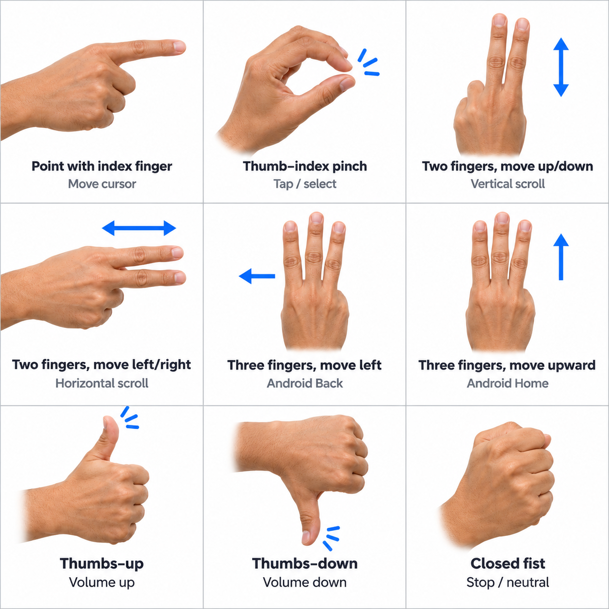

# GestureControl

GestureControl lets you control an Android tablet or phone with hand gestures
picked up by its front camera. It was developed and tested using a wall-mounted
Nokia T20, operated from around **60–90 cm** away.

You can move a cursor, pinch to tap, scroll, go Back or Home, and adjust media
volume. The app also includes a camera preview with hand landmarks, an in-app
cursor test area, and controls for tuning recognition and movement.

Built with **Kotlin, CameraX and MediaPipe**, with Android's AccessibilityService
handling system-wide actions. Tracking runs on-device, and camera frames stay in
memory. Background tracking uses a foreground service with a **Stop tracking**
notification.

## Gestures



Keep one whole hand visible in even lighting. For scrolling and navigation, tuck
your thumb toward your palm and curl the unused fingers.

| Action | Gesture |
| --- | --- |
| Move the cursor | Extend your index finger and move its tip. |
| Tap | Point at a target, then touch thumb tip to index tip and hold briefly. Release between taps. |
| Scroll | Extend index and middle fingers. Wait for **Scroll ready**, then move up, down, left or right. |
| Back | Extend index, middle and ring fingers. Wait for **Navigation ready**, then move left. |
| Home | Use the same three-finger pose, wait for readiness, then move upward. |
| Media volume | In gesture-volume mode, thumbs-up raises volume and thumbs-down lowers it. Hold for spaced repeats. |

Scrolling follows your hand's swipe direction. Moving upward usually reveals
content farther down a page. Close your hand briefly before each new navigation
attempt. A held pinch or navigation gesture performs one action.

## Device compatibility

The current build requires **Android 13 or later**, an **ARM64 or ARMv7 processor**,
and a working **front-facing camera**. Camera permission and manually enabled
accessibility access are needed for system-wide control.

Other compatible Android phones and tablets can use the setup steps below.
Physical-device testing currently covers the **Nokia T20 running Android 13**.
On a new device, check gesture recognition, cursor alignment in both orientations,
background tracking and the Stop action. Camera quality and processing speed may
require a different working distance or adjustments to the existing tuning controls.

## Build and install

On macOS, with Miniforge or Miniconda installed, run these commands from the
repository root.

```bash
bash scripts/setup-macos.sh
source scripts/env.sh
./gradlew --no-daemon assembleDebug test lint
```

The setup script installs JDK 17 and Android SDK 35 in an ignored, project-local
`.tools/` directory. Accept the Android SDK licences when prompted. Source
`scripts/env.sh` again in each new terminal. The first build downloads dependencies
and the hand-tracking model, which is bundled into the APK for offline use.

An existing toolchain also works. Set `JAVA_HOME` to JDK 17 and `ANDROID_HOME` to an
Android SDK with platform 35, Build Tools 35.0.0 and platform-tools, then run the
Gradle command directly.

On the device, enable **USB debugging** in Developer options, connect a data cable
and accept the computer's authorisation prompt. With one USB device connected, run

```bash
adb devices -l
adb -d install -r app/build/outputs/apk/debug/app-debug.apk
adb -d shell am start -n dev.gestureos/.MainActivity
```

## Try it on your device

1. Tap **Start camera** and grant camera access. Allow notifications so the
   background service's Stop action is easy to reach.
2. Try **Enable in-app cursor** and select a few targets to check pointing and
   pinching. The tuning controls let you adjust sensitivity, smoothing and timing.
3. For launcher and other-app control, open **Accessibility settings** from
   GestureOS. Under Downloaded/Installed apps, enable **GestureOS cursor control**
   and accept Android's prompt.
4. If Android shows **Restricted setting**, open **Settings → Apps → GestureOS → ⋮ →
   Allow restricted settings**, then return to Accessibility to enable the service.
5. Return to GestureOS and turn on **Enable system-wide cursor**. This also enables
   background tracking. Press Home and try pointing, pinching and scrolling.

System-wide control, the in-app cursor and gesture volume are mutually exclusive.
In-app cursor and volume actions require GestureOS to be visible. Control modes
start off on a cold launch. Rotation, screen lock and service
interruptions disarm system control, so enable it again when ready. Use **Stop
camera** in the app or **Stop tracking** in the notification to finish.

## Status and roadmap

**v0.6.2** has the core controls working on the **Nokia T20 running Android 13**.
Hand tracking, media volume, the system-wide cursor and pinch selection,
four-direction scrolling, Back/Home, background camera tracking and the
accessibility overlay have passed initial device testing.

### Planned work

- **Drag-and-drop (optional)** would add pinch-and-hold dragging, followed
  by release to drop. The main challenge is maintaining continuous touch contact
  while keeping ordinary pinch taps reliable.
- **Unified gesture control (high priority)** will bring cursor movement,
  selection, scrolling, navigation and volume into one mode. Gesture priority
  handling will prevent conflicting or accidental actions.
- **Hands-free activation (high priority)** will add deliberate gestures,
  such as a held open palm, to enable or suspend control. Camera tracking will
  need to keep running while interactions are suspended.
- **Screen wake and standby (experimental)** will investigate screen-off
  tracking and gesture-based wake on the T20. If that proves unreliable, the
  fallback is a low-brightness standby screen with an inactivity timeout and
  gesture-based restoration.
- **Optimisation and deployment (high priority)** will focus on responsiveness,
  stability, wall-mount calibration and resource use, alongside interface polish,
  GitHub documentation and a reproducible release build.

### Testing still needed

- Sustained use at both 60 cm and 90 cm, with each hand and varied lighting.
- Camera permission revocation, the camera privacy toggle and interruptions from
  other apps using the camera during system-wide control.
- Scrolling and Back/Home across a wider range of Android apps.
- Long-duration memory use, battery drain, battery temperature and thermal behaviour.
- Regression checks for every existing gesture as new features are added.
